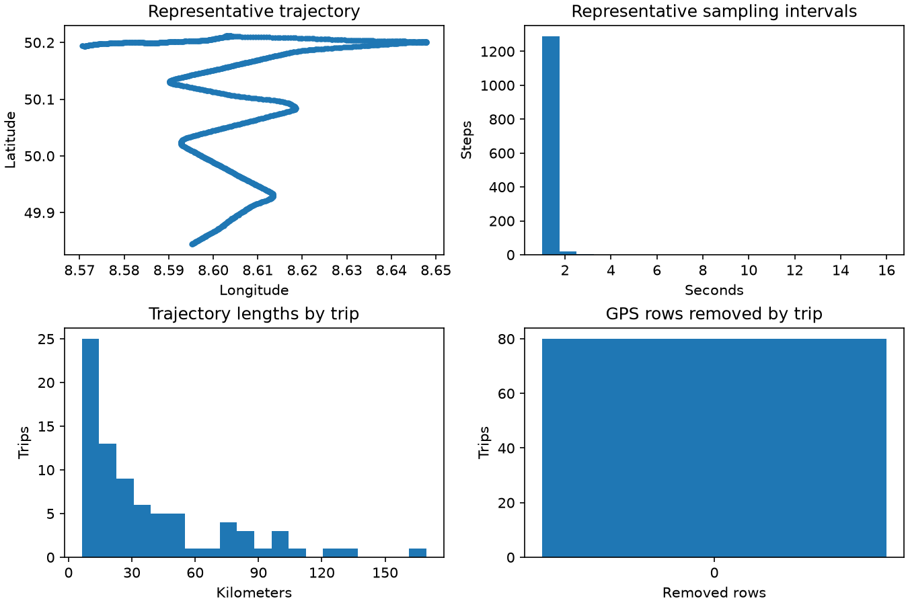
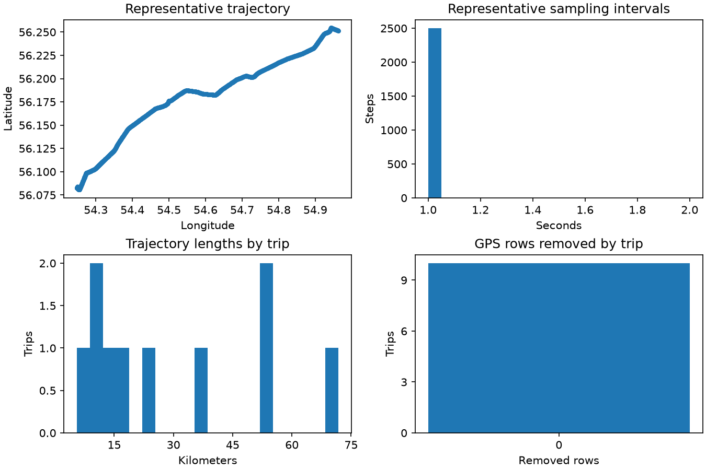
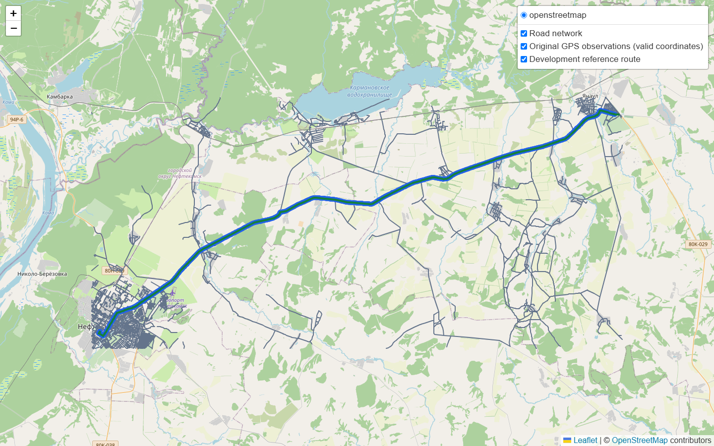

# Dataset understanding and preprocessing

The development workflow inventories same-stem .track, .nodes, .arcs, and
.route files by partition. GPS observations retain their original row IDs.
Road arcs retain their directed endpoints and positional arc IDs, including
parallel arcs. Weak components and isolates describe network connectivity.

Rows with missing, malformed, nonfinite, or out-of-range measurements are
removed. Within each trip the pipeline retains the original file order and
drops repeated or backward timestamps relative to the retained timeline.
It records irregular intervals and gaps over 30 seconds. Motion features are
masked across those gaps and across missing source rows.

For each trip, a WGS84 azimuthal equidistant projection centered on its first
road node gives local metric coordinates. Across the supplied data, the maximum
geodesic distance from any projection center to a GPS observation or road node
was 78.32 km in training and 42.20 km in student testing. Finite-segment
distances rank nearby candidates,
with a nearest-arc fallback where the search radius is empty. Directed arc
length, position, heading agreement, time and speed, candidate rank, and
endpoint degrees capture local geometry, motion, and connectivity. Reference
routes are aligned in traversal order by minimizing squared segment distances.
These derived labels can be uncertain around parallel roads or junctions.
Measure candidate misses before interpreting classifier performance.

## Findings from Student folder.zip

The source archive contains two development partitions with all four file
types present for every trip. The trip IDs are disjoint between partitions.
The ZIP SHA-256 is
`4804b0399d1d56f4844b9c74e2f998aae0a281fb5947a1f47ad1bd013214d248`.

| Measure | Training | Student test |
| --- | ---: | ---: |
| Trips | 80 | 10 |
| Raw files | 320 | 40 |
| GPS observations | 208,417 | 19,160 |
| Rows removed during cleaning | 0 | 0 |
| Steps with interval other than 1 second | 7,289 | 264 |
| GPS gaps greater than 30 seconds | 133 | 2 |
| Median trajectory length | 24.04 km | 20.97 km |
| Road node records | 1,933,485 | 90,689 |
| Directed arc records | 3,876,904 | 185,041 |
| Weakly connected components, summed over trips | 3,121 | 227 |
| Isolated nodes | 0 | 0 |
| Zero-length arcs excluded from candidate search | 100 | 6 |
| Candidate rows | 1,103,062 | 113,639 |
| Observations missing the aligned reference candidate | 24,180 (11.60%) | 79 (0.41%) |

Both partitions had zero missing or nonfinite GPS fields and zero
non-increasing timestamp steps. The reported road counts are sums of
trip-local records. Training trips `00000054` and `00000033` account for
21,449 of the 24,180 training misses. Misses include effects of the inferred
reference alignment as well as the candidate radius and cap, so this measure
describes coverage of the derived target.
In a systematic sample of every twentieth miss from those two trips, 1,013
of 1,074 observations were more than 50 m from every supplied reference arc.

## Report figures

### Figure 1. Training data exploration

The top panels show the GPS trajectory and sampling intervals for trip
`00000001`. The bottom panels summarize trajectory lengths and GPS rows removed
across all 80 training trips.

### Figure 2. Student-test data exploration

The top panels show the GPS trajectory and sampling intervals for trip
`00000000`. The bottom panels summarize trajectory lengths and GPS rows removed
across all 10 student-test trips.

### Figure 3. Folium map of student-test trip 00000000

Blue marks the original GPS observations, gray shows the road network, and
green shows the supplied reference route. The interactive export at
`outputs/student_test/sample_map.html` lets viewers toggle those layers.

The per-trip export also includes coordinate bounds, interval summaries, and
connectivity counts for both development partitions.
