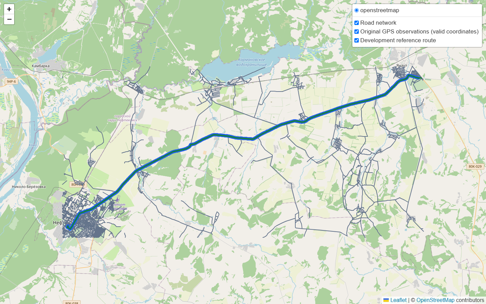

# ML_Hackathon_CS494_495_908_911
## Integrated route-recovery application

The [route-recovery guide](route_recovery/README.md) covers API/UI startup,
classifier emissions, optional reference evaluation and the separate UI server.
All five saved classifier families and the two optimized variants are connected.
The team's selected default is **optimized HistGradientBoosting**. The main
before/after HMM comparison is in the [selected-model report](reports/SELECTED_HGB_HMM.md).
See [measured integration results](reports/integrated_models/SUMMARY.md) and
[Member 4 status](reports/MEMBER4_STATUS.md) for verified behaviour and remaining
validation/deployment boundaries. To use the artifact-compatible environment:

```powershell
python -m pip install -r route_recovery/requirements-inference.txt
git lfs pull
python -m uvicorn route_recovery.main:app --host 127.0.0.1 --port 8020
```

Open http://127.0.0.1:8020. Run `python -m route_recovery.verify_integration`
to reproduce the saved-model integration checks without retraining.
For two devices, follow the [Laptop 1/Laptop 2 setup](route_recovery/DEPLOYMENT.md).

## Member 1 dataset pipeline

See [the model feature contract](FEATURE_CONTRACT.md) for the training schema.
Install the project requirements and provide one development partition at a time.
Extract `Student folder.zip` and pass its `train` and `student_test` folders
separately. Each trip's files share a basename and directory.

```sh
pip install -r requirements.txt
python dataset_exploration.py "Student folder/train" --labeled --output outputs/train
python dataset_exploration.py "Student folder/student_test" --labeled --output outputs/student_test
python dataset_exploration.py "Student folder/train" --labeled --serve
```

Open http://127.0.0.1:8001 for the development exploration page.
The export produces candidate and observation CSVs, per-trip EDA in JSON and CSV,
EDA plots, and an interactive Folium map for the first trip. Supply separate output folders
and keep the raw dataset and generated artifacts outside Git. Never pass the
reserved evaluator partition to the exploration page or labeled export.
Inference callers can load the evaluator input with `with_reference=False` and
build features with `labeled=False` during final evaluation.

### Dataset API and exploration page integration

The standalone app exposes `GET /api/data/trips` and
`GET /api/data/features?trip_id=<id>`. Pass a trip ID exactly as returned by
the inventory. The response pairs stable candidate IDs with ordered feature
column names, candidate rows, and cleaned observation records. An unknown ID
returns 404. The API skips reference files even when the development page
displays the reference route.

In the shared FastAPI app, include the data router for the intended partition
and mount the exploration page for development trips. These modules can be
used independently.

```python
from fastapi import FastAPI
from data_api import create_data_router
from dataset_exploration import create_app

app = FastAPI()
development_dir = "Student folder/student_test"
app.include_router(create_data_router(development_dir))
app.mount("/eda", create_app(development_dir, labeled=True))
```

For the final evaluator app, use the router with the evaluator input partition
when authorized for the live demo. Mount any labeled exploration page only
against development data. Server-side evaluation owns reference access.
In the combined inference endpoint, call the loader and feature builder
directly if the model, HMM, and data pipeline are running in the same process.

### Dataset exploration preview



The map shows raw GPS observations in blue, the road network in gray, and the
supplied reference route in green. The [dataset report](DATASET_REPORT.md#report-figures)
includes the training and student-test EDA plots.


# Development route recovery

## Restored Member 4 interfaces

The team selected HistGradientBoosting. The default is the existing
`hist_gradient_boosting_optimized` artifact in the API and UI. The main comparison
is that classifier alone versus that same classifier plus HMM. No models or
training scripts were changed. `/health` still discovers the five classifier
families and two optimized variants for supporting experiments.

The [selected-model report](../reports/SELECTED_HGB_HMM.md) documents the pooled
Top-1 change, **81.92% to 79.49% (-2.43 percentage points)**, and continuity change,
**85.25% to 98.27%**. The team choice is not presented as a new cross-validation
finding. `/selected-model` exposes aggregate development measurements only when
their SHA-256 matches the saved artifact. The UI shows this aggregate panel
separately from optional current-trip evaluation, including the accuracy delta.

Logistic Regression, Decision Tree and KNN are loaded from `../models/`.
Random Forest and HistGradientBoosting baselines are loaded from
`../outputs/models/`; optimized variants come from `../outputs/optimization/`.
Run `git lfs pull` after cloning to obtain the actual large model files.
The server reports an actionable error if a pointer was downloaded instead.
Only one classifier is cached, to limit retained Random Forest memory.

`classifier.py` validates saved feature names/order, binary class labels and
scikit-learn version compatibility. It batches positive-class probabilities,
clips them at 1e-12 and normalises each observation's candidate set before
taking log emission scores. These are emission potentials, not calibrated GPS
likelihoods. Model files are read-only and only server-configured paths may be
loaded. When a model version differs, use the training-compatible environment;
do not suppress persistence warnings.

Set `PATHSNAP_MODEL_ARTIFACT` on the server to expose a trusted future artifact
as `configured`, without editing the HMM. It must expose sklearn-style
`predict_proba`, classes {0,1} and the exact shared ordered feature names.
Unrecognised formats fail explicitly rather than silently falling back.

Reference evaluation is optional (`evaluate: true`) and happens after prediction
in `evaluation.py`. Labels, reference IDs and reference geometry are never
returned. Top-1 includes all cleaned observations, including candidate misses.
The response distinguishes candidate binary Macro F1 from within-trip road-arc
Macro F1. Continuity counts speed-valid directed transitions among eligible
adjacent observations, including unmatched/invalid eligible pairs as failures;
timestamp and original-row gaps are excluded. Exact-trip match is also reported.
The existing reference alignment is derived and may be ambiguous.

```powershell
python -m route_recovery.compare_routes student_test --model decision_tree --output reports/member4_classifier_hmm.json
```

To verify every available saved model through `/match`, optional evaluation and
`/visualize`, without retraining:

```powershell
python -m route_recovery.verify_integration
```

Per-model reports and their combined summary are written to
[`../reports/integrated_models/`](../reports/integrated_models/).
These use the ten development student-test trips and derived reference labels;
they are not a training cross-validation leaderboard or reserved evaluation.

This command never trains or tunes a model and only accepts development partition
names. It reports per-trip results, pooled all-observation Top-1, mean per-trip
road-arc Macro F1, continuity and inference time. No HMM accuracy improvement is
assumed. Model selection and tuning decisions remain with the team.

The evaluator input defaults to the repository's `evaluator_test` folder.
Override it with `PATHSNAP_EVALUATOR_INPUT` when the uploaded data is elsewhere.
Reference evaluation remains separate: configure `PATHSNAP_EVALUATOR_REFERENCE`
to a server-side root containing `<inventory_trip_id>.route`, preserving any
relative subfolders. The evaluator's route files are not read during inventory
or prediction. No reserved data was used in these development checks.

Trip selection is preserved on refresh of the dropdown, and the request snapshots
the chosen trip before controls become busy. JavaScript is served as `app.js`
by both the integrated API and the separate UI app.

## Shared data integration

The API now uses Member 1's `load_trip(with_reference=False)` and
`build_feature_table(labeled=False)` through `data_adapter.py`. Candidate lists,
order, distances and fractions come directly from the training feature table.
Defaults match the feature contract: radius 50 m, up to 8 directed arcs, and
nearest-arc fallback. Projection is the shared local azimuthal equidistant CRS.
Original observation IDs are returned, and removed rows split decoding sections.
The old standalone RoadTrip remains only for isolated decoder tests.

Set the dataset parent directory before starting, if it is outside the repo:

```powershell
$env:PATHSNAP_DATA_ROOT = 'C:/path/to/Student folder'
python -m uvicorn route_recovery.main:app --host 0.0.0.0 --port 8000
```

Trip IDs now follow the shared inventory (for example `00000052/00000052`).
Clients must use IDs returned by `/trips`; arbitrary paths are never accepted.
No reference route is loaded during feature preparation or prediction.

## Student-test execution check

Run `python -m route_recovery.check_trips student_test` to reproduce the
execution check. Measured results are in
[`../reports/student_test_execution.json`](../reports/student_test_execution.json).
All ten supplied student-test trips completed with valid output shapes. Some
have many unreachable-transition breaks (97 for trip 00000040); these are
explicit route discontinuities, not successful continuity or accuracy results.
Investigate candidate coverage and decoder assumptions with the model owners
before drawing conclusions or selecting decoder parameters.

Distance-based emissions remain a baseline; optional classifier emissions and
isolated server-side reference evaluation are supported as described above.

From the repository root, with requirements installed:

```sh
python -m unittest discover -s tests -v
uvicorn route_recovery.main:app --host 0.0.0.0 --port 8000
```

For the verified artifact-compatible environment, install with
`python -m pip install -r route_recovery/requirements-inference.txt`.
This pins scikit-learn to 1.8.0 without changing the teammates' model definitions.

Open http://localhost:8000. Laptop 2 can open http://LAPTOP_1_LAN_IP:8000 on
the same network. Allow port 8000 if the firewall prompts. API logs appear on
Laptop 1. Folium assets and map tiles need internet access. `/docs` has API docs.
For separate Laptop 2 hosting, run
`python -m uvicorn route_recovery.ui_server:app --port 8080` on Laptop 2 and
enter Laptop 1's API address in the page. See [deployment steps](DEPLOYMENT.md)
for allowed origins, network configuration and physical-device verification.
The UI shows runtime, matched/unmatched counts, road sections, break details
and map layers. The `/visualize` endpoint returns the results and map together.
The trip picker uses the evaluator partition and automatically requests
server-side reference scoring. Development partitions are available through
the API and its connection check.
Diagnostic mode reports why transitions failed without changing predictions;
see [measured findings](../reports/ROUTE_BREAK_FINDINGS.md).

## Algorithm and integration

Viterbi accepts natural-log emission scores and previous-by-next transition
matrices. Negative infinity means impossible. Initial priors are uniform up to
a constant. Ties choose the first candidate. Returned indices refer to each
observation's own candidate list, preserving arc correspondence.

`recover(trip, scorer=callback)` accepts a callback `(observation, candidates)`
returning aligned log scores. Candidate fields: arc_id, fraction along directed
arc, distance_m and projected xy. Agree on feature ordering and probability
conversion with classifier owners before connecting their artifacts.

Transitions penalise network-versus-observed distance mismatch. Directed
Dijkstra includes partial end arcs. Speed and timestamp gap thresholds are
configurable. No candidates or impossible transitions produce explicit breaks;
missing matches remain null and geometry never bridges a break.

The API uses the shared indexed candidate queries. Dijkstra uses a bounded
cache. Benchmark large trips before demonstration. Decoder scoring defaults are
engineering starting points, not optimised parameters.
