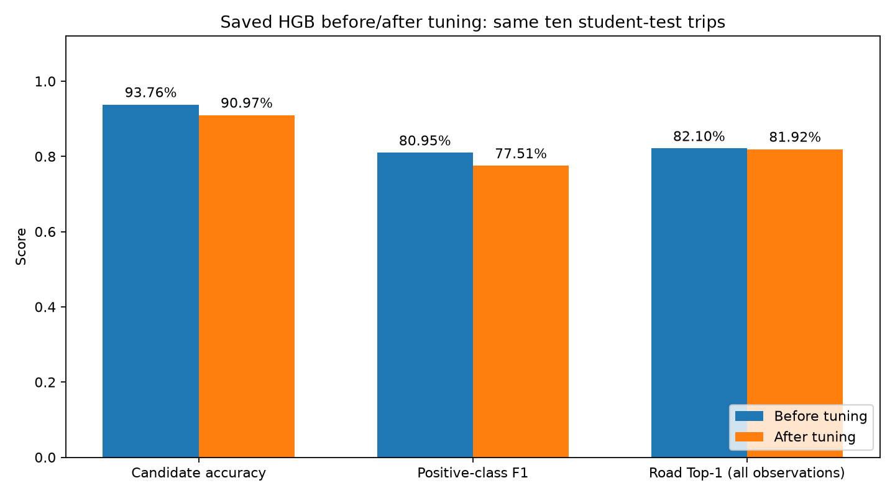
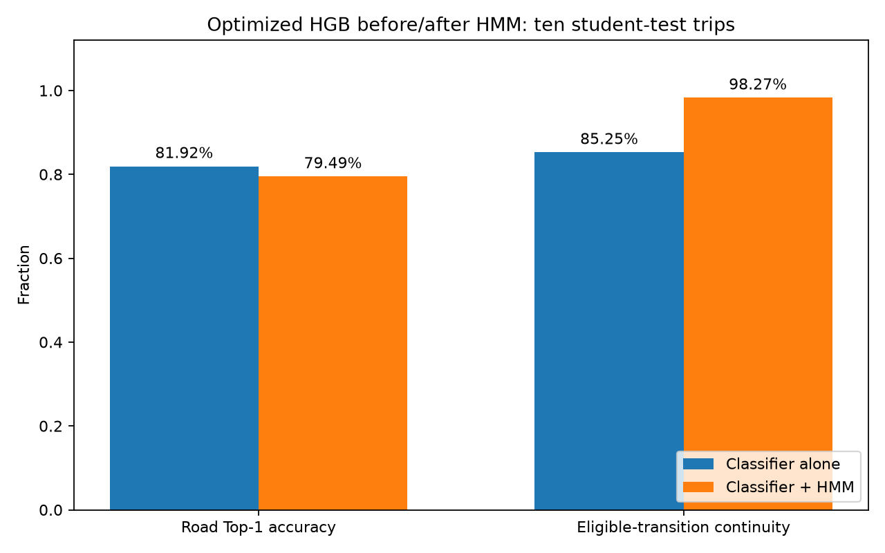
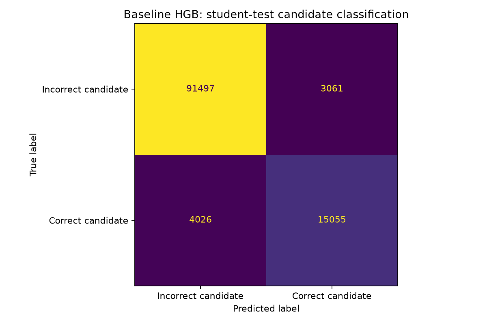
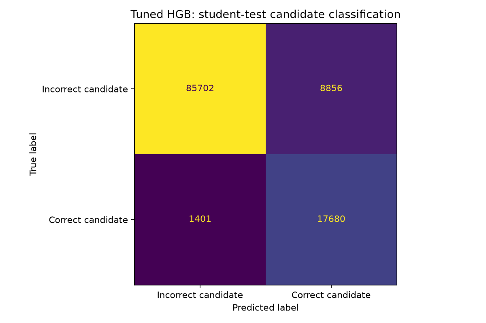
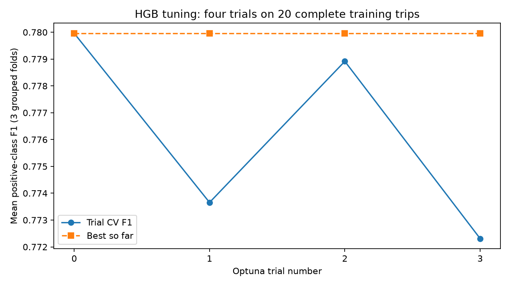

# PathSnap next-review guide

## What is ready and what is not

| Review item | Status | Evidence / limitation |
|---|---|---|
| Hyperparameters used | Ready | saved_hyperparameters.json reads the actual saved artifacts, not just model factories |
| Accuracy before/after HMM | Ready | selected HGB comparison across 10 trips / 19,160 observations |
| Accuracy before/after tuning | Ready, measured for this review | hgb_tuning_comparison.csv compares identical data/candidates/derived labels |
| Tuning improves accuracy | Not supported | candidate accuracy and road Top-1 both decrease |
| Adaptive Bayesian search | Not demonstrated by recorded run | only 4 trials; current TPESampler startup default is 10 |
| HGB is universally the best model | Not established | team-selected deployment model; no common five-model validation table found |
| Plots for HGB results | Ready | before/after tuning, before/after HMM, two confusion matrices and trial history |
| Physical Laptop 2 request reaches Laptop 1 | User-supplied log confirms successful remote request | 10.30.203.4 GET requests and POST /visualize return 200; retain Laptop 2 screenshot to prove displayed reception |
| Entire requirements rubric | Not certified | original requirements PDF was not found in this checkout; map these files to the actual rubric |

No training artifacts, model defaults or application inference code were changed by this review audit. The evidence generator is ../../route_recovery/review_evidence.py. Reproduce from the project root with `python -m route_recovery.review_evidence`.

## The project in one explanation

GPS points are noisy and can lie beside a road or near several roads. PathSnap generates nearby directed road candidates for each GPS observation, calculates numerical features for every candidate, and uses a classifier to score whether each candidate is the correct road. HMM/Viterbi then uses these candidate scores and directed network travel distances to recover a plausible sequence. A valid connected route is useful, but it is not automatically the true route.

The classifier does binary candidate scoring, not a global classification over road IDs. Arc IDs are local to each trip. HMM hidden states are the candidate road positions; the observed values are the GPS readings. Viterbi is the dynamic-programming decoder used to select the best-scoring sequence under the HMM assumptions.

## Dataset and preprocessing questions

- 80 training trips and 10 student-test development trips.
- 208,417 training GPS observations and 19,160 student-test observations.
- .track: longitude, latitude and timestamp for each GPS observation.
- .nodes: road-node coordinates; the row index is its node ID.
- .arcs: directed start/end node IDs; the row index is its arc ID.
- .route: ordered reference arc sequence, not a direct GPS-row-to-arc label table.
- Training candidate rows: 1,103,062; student-test candidate rows: 113,639.
- Zero GPS rows were removed in this archive. Cleaning still validates malformed/nonfinite/out-of-range fields and non-increasing timestamps.
- Recorded anomalies: 133 training and two student-test gaps over 30 seconds; 100 training and six student-test zero-length arcs excluded from candidate search; irregular sampling; multiple weak graph components.
- Candidate misses of derived targets: 11.60% train and 0.41% student test. Do not call every miss a GPS error: reference alignment is derived and can be ambiguous.
- Local azimuthal equidistant projection converts coordinates into metres for distance/heading calculations. Longitude and latitude degrees are not metre units.
- Candidate radius 50 m; at most eight directed arcs. With no candidate inside the radius, nearest-arc fallback is used. Reference arcs are never injected.
- Motion context is masked for missing source rows, zero motion or intervals over 30 seconds.
- Fit/cross-validate on training trips; group by trip_id so candidate rows from a trip do not cross outer folds. Student-test is separate development evaluation, not the reserved evaluator.

### The 11 features

| Feature | Explanation |
|---|---|
| distance_to_road_m | GPS distance to the finite candidate segment |
| along_segment_fraction | Position from 0 to 1 along the directed segment |
| segment_length_m | Segment length in metres |
| heading_error_deg | Difference between GPS movement direction and road direction |
| gps_step_distance_m | Distance since the preceding valid GPS observation |
| time_delta_s | Time interval since that observation |
| gps_speed_mps | Step distance divided by time |
| has_motion_context | Whether the motion/heading features are usable |
| candidate_rank | Rank by road distance, with deterministic ties |
| from_node_in_degree | Incoming arc count at the start node |
| to_node_out_degree | Outgoing arc count at the end node |

There is one binary target for a candidate: 1 if its arc equals the derived reference arc, else 0. With a candidate miss, all candidates at that observation have target 0. Reference routes are used for labels/evaluation, not inference inputs.

## Why the five models exist

| Model | What it learns | Why included | Important limitation |
|---|---|---|---|
| Logistic Regression | Linear boundary on scaled features | Simple, fast probabilistic baseline | Limited nonlinear interactions |
| KNN | Labels/probabilities from similar scaled feature rows | Local similarity baseline | Expensive inference; training is sampled to 100,000 rows |
| Decision Tree | Feature-threshold rules | Interpretable nonlinear baseline | Can overfit and give extreme probabilities |
| Random Forest | Many bootstrap-trained trees whose probabilities are averaged | Robust nonlinear ensemble | Large model files/memory |
| HistGradientBoosting | Sequential trees improving the current loss using binned numerical features | Efficient nonlinear learner for numerical tabular candidates | Does not model a complete route sequence by itself |

Trees do not require the same feature scaling as LR/KNN. HGB binning makes split searches efficient; gradient boosting is sequential error/loss correction, whereas Random Forest trains randomized trees and averages them.

## Hyperparameters actually saved

Full values are in [saved_hyperparameters.json](saved_hyperparameters.json).

| Model | Key parameters |
|---|---|
| Logistic Regression | StandardScaler; C=1; max_iter=300; solver=lbfgs; class_weight=balanced; seed=42 |
| KNN | StandardScaler; n_neighbors=5; weights=distance; metric=Minkowski p=2 (Euclidean); algorithm=brute; n_jobs=-1 |
| Decision Tree | max_depth=20; min_samples_split=20; min_samples_leaf=10; criterion=gini; class_weight=balanced; seed=42 |
| RF baseline | 150 trees; max_depth=None; max_features=sqrt; min_samples_split=2; min_samples_leaf=2; class_weight=balanced_subsample; n_jobs=-1 |
| RF tuned | 100 trees; max_depth=None; max_features=0.7; min_samples_split=7; min_samples_leaf=3; class_weight=balanced; n_jobs=1 |

### HGB before/after tuning

| Parameter | Baseline | Tuned |
|---|---:|---:|
| learning_rate | 0.1 | 0.0656232493 |
| max_iter | 100 | 180 |
| max_leaf_nodes | 31 | 34 |
| min_samples_leaf | 20 | 38 |
| l2_regularization | 1.0 | 0.0037766633 |
| class_weight | None | balanced |
| early_stopping | True | True |
| max_bins | 255 | 255 |
| validation_fraction | 0.1 | 0.1 |
| n_iter_no_change | 10 | 10 |
| random_state | 42 | 42 |
| actual boosting iterations | 100 | 180 |

- learning_rate controls each boosting update's contribution. Smaller updates often need more iterations.
- max_iter caps boosting rounds; max_leaf_nodes limits each tree's complexity.
- min_samples_leaf prevents small overly specific leaves.
- L2 penalizes leaf values. Larger values impose stronger regularization.
- balanced class weights increase the relative importance of the rarer positive candidates. This is another difference between the baseline and tuned training recipes, so the experiment does not isolate the effect of one parameter.
- Early stopping is enabled, but both saved models reached their maximum iterations. Do not claim early stopping actually stopped these two fits early.

## How tuning was performed, and its limitations

The optimizer uses Optuna's TPESampler(seed=42), maximizes mean positive-class F1 (`scoring='f1'`), and uses three GroupKFold splits on 20 complete training trips. The best settings are refit on all supplied training rows. Four trials are recorded for each advanced model.

HGB search space: learning_rate 0.04-0.15 (log); max_iter 80/130/180; max_leaf_nodes 15-40; min_samples_leaf 20-50; L2 0.001-5 (log). Balanced weighting and early stopping are fixed in this search.

The best recorded HGB trial is trial 0, mean validation F1 **0.7799586**. Its fold scores are 0.69454, 0.78915 and 0.85619. That is not accuracy, not student-test performance and not a before/after improvement estimate. An untuned score under the identical 20-trip three-fold protocol is not recorded here.

Important: the current installed TPE default has n_startup_trials=10, while this run has four trials. Thus the current code/run does not demonstrate adaptive TPE proposals after the startup phase. More than ten trials, or an explicitly justified smaller startup budget with enough following trials, is needed to demonstrate adaptive Bayesian search. More trials do not guarantee improvement. This is teammate-owned optimization work; it was not silently rerun during this audit.

Tuned Random Forest's recorded best F1 is 0.7972903 on that tuning protocol, above HGB's 0.7799586. Do not say HGB wins every metric. HGB is the team's deployment selection; its smaller artifact and good end-to-end performance are practical considerations. A complete five-model validation comparison under one documented protocol remains necessary to defend a universal best-model claim.

## Accuracy before/after tuning: same evaluation data

Measured on the same ten student-test trips, 19,160 observations and 113,639 candidate rows. Binary predictions use a 0.5 positive probability threshold. Top-1 picks one highest-scoring candidate per observation and includes candidate misses as errors.

| Metric | Baseline HGB | Tuned HGB |
|---|---:|---:|
| Candidate binary accuracy | 93.76% | 90.97% |
| Positive precision | 83.10% | 66.63% |
| Positive recall | 78.90% | 92.66% |
| Positive F1 | 80.95% | 77.51% |
| Binary Macro F1 | 88.61% | 85.93% |
| Log loss (lower is better) | 0.1519 | 0.2158 |
| Road Top-1, all observations | 82.10% | 81.92% |

Candidate accuracy changes by **-2.79 percentage points**; road Top-1 by **-0.19 points**. Tuning raises recall but reduces precision, accuracy and F1 on this evaluation. The class-weight change is consistent with the increase in positive predictions, but several settings changed and this is not a causal ablation.

A truthful review answer: “We optimized grouped validation F1. The chosen trial did not improve held-out accuracy. It traded higher recall for more false positives, which our evaluation exposes.”

Source: [comparison CSV](hgb_tuning_comparison.csv), [full metrics](hgb_tuning_comparison.json).

## Accuracy before/after HMM

For the team's selected tuned HGB on all ten trips:

| Metric | Classifier alone | Same classifier + HMM |
|---|---:|---:|
| Road Top-1, all observations | 81.92% | 79.49% |
| Eligible-transition continuity | 85.25% | 98.27% |
| Mean trip road-arc Macro F1 | 0.6703 | 0.7837 |
| Exactly correct complete trips | 0 | 0 |

HMM accuracy changes by **-2.43 percentage points**; continuity by **+13.02 points**. Do not compare 90.97% binary candidate accuracy to 79.49% road Top-1: their units of evaluation differ.

Trip 00000052 improves 94.27% to 99.62%, but trip 00000077 drops 64.02% to 48.66% and dominates the pooled decrease. A good single-trip demonstration does not override the aggregate.

### HMM settings and logic

- Hidden states: up to eight candidate directed road positions per GPS reading.
- Emission potential: take each candidate's classifier P(target=1), clip to at least 1e-12, normalize within that observation, then take its natural log. These are scoring potentials, not a claim of calibrated GPS likelihoods.
- Transition score: `-abs(network_distance - observed_GPS_step_distance) / beta_m`, with beta_m=30 m.
- Shortest directed travel distance includes partial endpoint arcs, using Dijkstra. A backward move on a one-way arc needs a valid directed return path.
- Maximum speed budget: 60 m/s (216 km/h), an engineering threshold, not road-specific legal speed-limit data.
- Split at time gaps over 30 s, removed observations, missing candidates or impossible transitions.
- Viterbi chooses the path with the maximum sum of log emission and transition scores; log space avoids numerical underflow. Missing links have negative-infinite score.
- sigma_m=20 belongs to the distance-only Gaussian baseline. It is not the classifier-emission parameter for the selected HGB run.

Why accuracy can drop: enforcing a plausible directed sequence can override individually correct choices. Transition assumptions, candidate coverage, projection jitter and ambiguous reference alignment can disagree with per-point labels. The measurements prove a trade-off, not one uniquely identified cause. All models have 334 breaks: 329 speed-budget, two component, one direction and two timestamp-gap breaks. Do not force connectors or tune against these test results to conceal them.

## How to explain each plot

### Before/after tuning



X-axis: three different evaluation metrics; Y-axis: score from 0 to 1. Blue is baseline, orange tuned. The tuned bars are lower for accuracy, F1 and Top-1. Say the tuning objective was training-validation F1 and the observed held-out outcome is not an improvement. Do not compare heights of different metric categories as if they measured the same thing.

### Before/after HMM



X-axis: road Top-1 and continuity; Y-axis: fraction. HMM lowers Top-1 but raises continuity. Continuity measures feasible directed transitions, not correct road identity. No whole trip was exactly matched.

### Confusion matrices





Rows are true labels; columns are predicted labels. Positive means a correct road candidate, not a correctly reconstructed whole trip.

| Count | Baseline | Tuned | Meaning |
|---|---:|---:|---|
| TN | 91,497 | 85,702 | Incorrect candidate correctly rejected |
| FP | 3,061 | 8,856 | Incorrect candidate labelled correct |
| FN | 4,026 | 1,401 | Correct candidate missed |
| TP | 15,055 | 17,680 | Correct candidate accepted |

The tuned model misses fewer positives but accepts many more incorrect candidates. Accuracy=(TP+TN)/all; precision=TP/(TP+FP); recall=TP/(TP+FN); F1 is the harmonic mean of precision and recall. Many candidate rows are negative, so accuracy alone is insufficient. Macro F1 averages the two classes' F1 values; it is not the same as positive-class F1.

### Optimization history



X-axis: trial number; Y-axis: mean positive F1 across three grouped folds. Blue is the trial score; orange is best so far. Trial 0 remains best, so the orange line is flat. The Y-axis is zoomed to show small differences. This is four startup-phase trials, not evidence of broad/adaptive search or validation accuracy.

### Dataset exploration figure

Open [student-test EDA](../../docs/figures/student-test-eda.png):

- Top left: longitude against latitude for a representative raw trajectory. This is not a predicted route or an accuracy plot.
- Top right: sampling interval in seconds against number of steps. Most are near one second for this representative trip; this does not prove every dataset interval is one second.
- Bottom left: trajectory length in km against number of trips; demonstrates trips have different lengths. Long trips contribute more to pooled pointwise accuracy.
- Bottom right: removed-row count against number of trips. All ten supplied student-test trips needed zero GPS-row removals. Validation was still implemented.

Existing model comparison charts may cover only LR/DT or three sampled models; read their source CSV and sampling/fold scope. Do not describe them as a common five-model full-data evaluation. RF confusion-matrix evidence was not found in the current results directory.

### Maps

In the integrated inference UI: blue GPS observations, green predicted HMM road sections, purple independent road selections, grey road network, orange breaks. In the older Member 1 EDA map, green means supplied reference route. Always identify which map you are showing. A green line is not automatically ground truth.

## API log and where it comes from

The flow is: Laptop 2 browser -> HTTP request -> Laptop 1 FastAPI -> preprocessing/candidate features -> HGB probabilities -> HMM/Viterbi -> optional server-side evaluation -> JSON/map response -> Laptop 2 browser renders it.

Laptop 2 serves the HTML/JavaScript locally at localhost:8080. Its browser sends fetch requests to Laptop 1's actual API IP on port 8000. The Python UI server does not run the classifier or proxy the route request. The terminal log appears on Laptop 1 because that is where Uvicorn/FastAPI handles the request.

The user supplied this actual remote request log:

```text
INFO:     10.30.203.4:60529 - "GET /health HTTP/1.1" 200 OK
INFO:     10.30.203.4:60529 - "GET /trips HTTP/1.1" 200 OK
INFO:     10.30.203.4:60529 - "GET /selected-model HTTP/1.1" 200 OK
INFO:     Starting route reconstruction: student_test/00000000/00000000 model=hist_gradient_boosting_optimized
INFO:     Matched student_test/00000000/00000000: 2503/2503 in 6.74s
INFO:     10.30.203.4:56992 - "POST /visualize HTTP/1.1" 200 OK
```

- 10.30.203.4 is the requesting client IP; confirm it matches Laptop 2.
- 60529/56992 are temporary client source ports. Changing ports is normal; they are not API port 8000.
- GET /health: API availability and model inventory/default.
- GET /trips: available dataset trip IDs.
- GET /selected-model: saved selected-model aggregate comparison.
- POST /visualize: JSON request specifying trip/partition/model/options; response contains computed result and map HTML. If model is omitted, optimized HGB is the default.
- 200 OK: request was processed successfully, not proof predictions are correct.
- 2503/2503: every observation received an assignment, not 100% road accuracy.
- 6.74 s: inference elapsed time for this run; optional evaluation and map preparation are separately outside this elapsed measure.
- The missing OPTIONS line is not automatically an error: CORS preflight may have been cached or simply outside this pasted excerpt.

### What to show live

1. Show the Laptop 1 backend terminal running on port 8000.
2. On Laptop 2 open localhost:8080, enter Laptop 1's actual IP:8000 and click Connect.
3. Explain the three GET log entries.
4. Select a trip and click Reconstruct route; show POST /visualize from Laptop 2's IP on Laptop 1.
5. Show the received map/results on Laptop 2. In browser Developer Tools -> Network, select /visualize to show the request URL, method, JSON payload and response status. Optional evaluate=true produces aggregate reference metrics after prediction.
6. Show both the all-ten-trip panel and current-trip comparison. Keep the aggregate accuracy decrease visible.

To save the backend terminal output, stop it with Ctrl+C and restart from the repo root:

```powershell
powershell -NoProfile -File .\route_recovery\start_api.ps1 2>&1 | Tee-Object -FilePath .\backend.log -Append
```

That creates backend.log after starting. The receiving-laptop check can also save reports/laptop2_connection.json; see [deployment instructions](../../route_recovery/DEPLOYMENT.md). IPs can change after reconnecting Wi-Fi; verify with ipconfig.

## Questions you should be able to answer

- What is the problem? Recover a likely road journey from noisy GPS points.
- Why not choose the nearest road? Parallel roads, intersections and one-way direction make local proximity unreliable.
- What does the model predict? Correctness/probability for each candidate observation-road pair.
- Why HMM after a classifier? Per-observation classification ignores sequence connectivity; HMM adds transition consistency.
- Is HMM trained here? The classifier is supervised; transition/emission conversion and decoder thresholds are engineered. No Baum-Welch training of an HMM is implemented.
- Why log probabilities? More stable sums over long trips instead of underflowing products.
- Why GroupKFold? Correlated rows from a trip remain in one outer fold.
- What is tuning? Searching model settings; different from fitting weights/tree splits.
- Was tuning successful? It produced a selected trial, but did not improve held-out accuracy/F1 here. Four startup trials are a limited search.
- Why HGB selected? Team choice of deployment classifier. Do not claim a proven universal five-model CV win.
- What is road connectivity? Ability to travel along directed arcs from one candidate position to the next, subject to the time/speed budget. This is route connectivity, not a special HMM root node.
- How do you handle impossible transitions? Start another section, report a reason, and avoid drawing a fictional connector.
- What does matched mean? A candidate assignment was returned; it does not imply correctness.
- How is reference leakage avoided? Inference loads no route labels; evaluation explicitly runs afterward on the server.
- Is optimized always better? No. An artifact name describes how it was obtained, not a guarantee of higher held-out accuracy.
- What remains uncertain? Derived labels, transition assumptions, limited tuning budget and absence of one comparable five-model CV table. These do not invalidate successful API integration, but they limit experimental claims.
