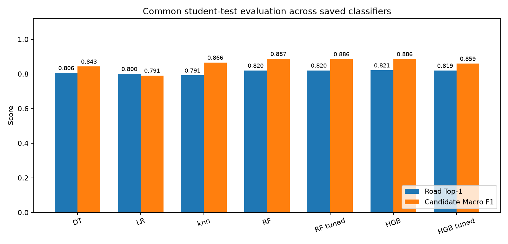
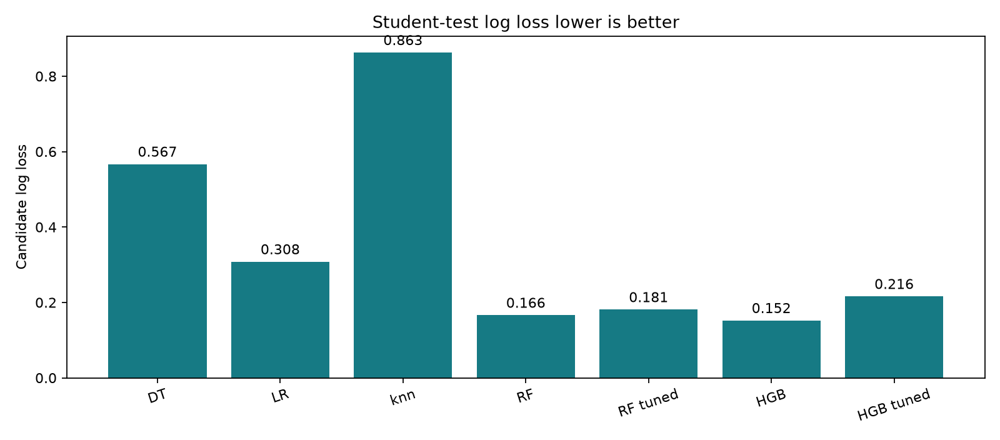
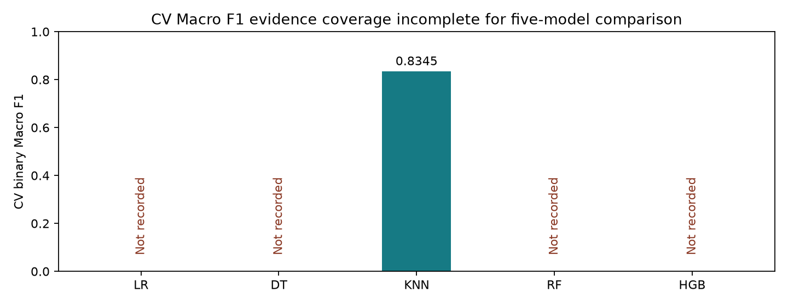
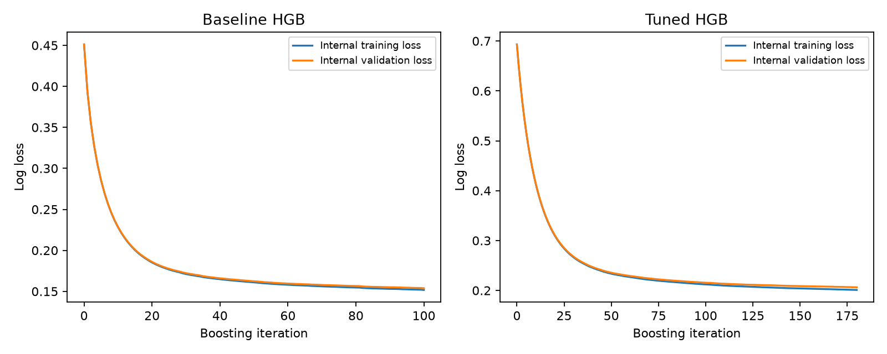
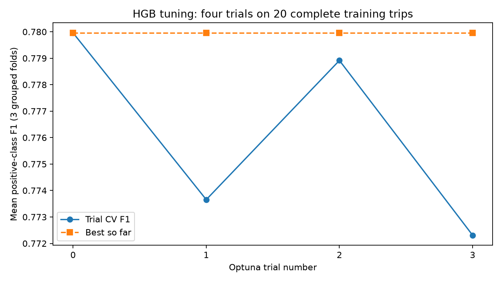
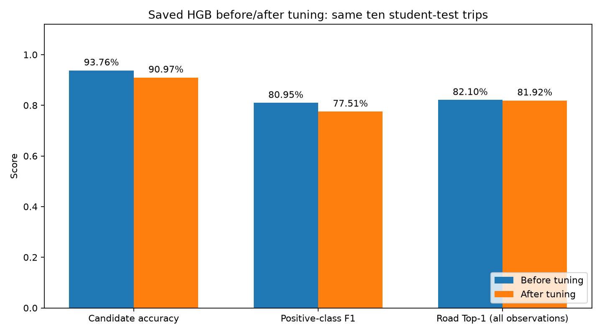
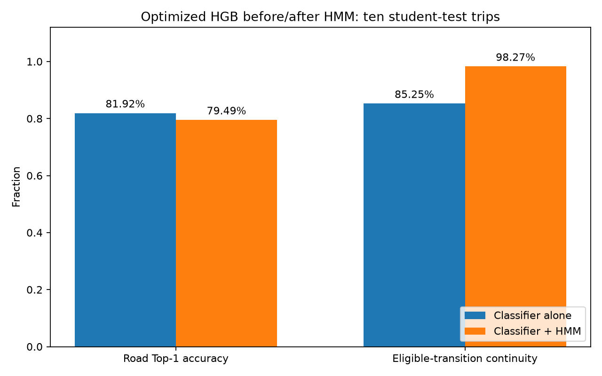
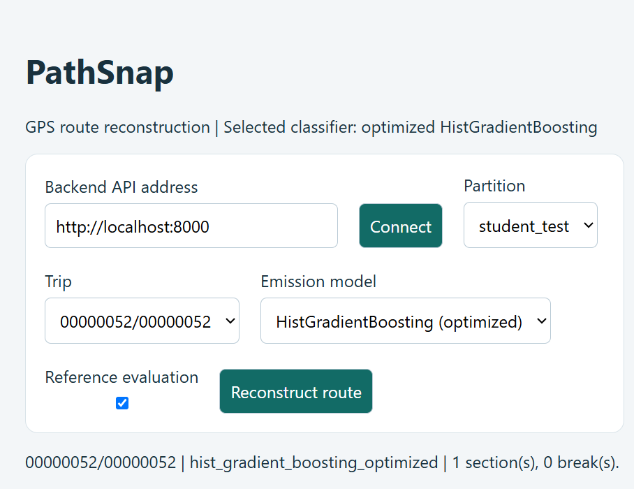

# PathSnap Technical Report

GPS trajectory map matching with supervised candidate scoring and HMM Viterbi decoding

Team CS494 CS495 CS908 CS911 | Machine Learning Hackathon | 18 November 2026

Repository: https://github.com/KOTRASAISOUMYASRI/ML_Hackathon_CS494_495_908_911

Implementation branch: feature/member4-hmm-integration. Evidence baseline: commit 89e3004, with additional report-time student-test measurements and geographical exports.

## Project outcome

PathSnap converts noisy GPS readings into road-based route sections. We implemented data inspection and preprocessing, eleven numerical candidate features, five supervised classifier families, saved baseline and tuned models, log-space HMM/Viterbi decoding, Folium visualisation and a FastAPI application with a separately served UI.

The team-selected deployment classifier is the optimized HistGradientBoosting artifact. On ten student-test trips, its independent road-selection Top-1 is 81.92%; adding HMM gives 79.49%. Directed-transition continuity rises from 85.25% to 98.27%. The route becomes more connected but pointwise road accuracy falls. These outcomes are reported separately rather than presenting continuity as accuracy.

| Evidence scope | Value |
| --- | --- |
| Training partition | 80 trips; 208,417 GPS observations |
| Student-test partition | 10 trips; 19,160 observations; 113,639 candidate rows |
| Models documented | Five families; seven saved variants |
| Integration verification | 70 model-trip runs and seven map endpoint checks; 25 regression tests passed |
| Distributed execution | User-supplied server log records successful remote requests from 10.30.203.4 |

The report follows deliverable sections 2 through 7. Missing common CV Macro F1 values and the receiving-laptop terminal screenshot are explicitly identified in the submission checklist. No missing metric is replaced by an unrelated score or an invented graph.

# 2 Dataset Understanding and Exploratory Data Analysis

## 2.2 Dataset partitions and file contents

The development archive has disjoint training and student-test trip IDs. Each trip has same-stem .track GPS readings, .nodes road coordinates, .arcs directed endpoint pairs and a .route reference arc sequence. Node and arc IDs are positional row indices local to a trip. The reference sequence is not a per-GPS-row label table. [S1, S2]

| Measure | Training | Student test |
| --- | --- | --- |
| Trips | 80 | 10 |
| GPS observations | 208,417 | 19,160 |
| Candidate rows | 1,103,062 | 113,639 |
| Missing/nonfinite GPS fields | 0 | 0 |
| GPS rows removed | 0 | 0 |
| Non-increasing timestamp steps | 0 | 0 |
| Intervals other than one second | 7,289 | 264 |
| Gaps greater than 30 seconds | 133 | 2 |
| Zero-length arcs excluded | 100 | 6 |
| Derived target candidate misses | 24,180 (11.60%) | 79 (0.41%) |

## Preprocessing and observed patterns

The loader validates coordinate ranges, numeric fields and road endpoint indices. Cleaning retains source row IDs and original order, removes invalid GPS rows, and rejects repeated/backward timestamps relative to the retained timeline. This archive required no GPS-row removal; that is an observed result, not the absence of a validation pipeline.

Coordinates are projected to a trip-local WGS84 azimuthal equidistant CRS for metre-based geometry. Zero-length arcs are excluded from candidate queries. Sampling gaps and removed source rows mask motion features and split the decoder timeline. Directed graph components and arc identities are preserved; one-way roads are not silently reversed.

Trip lengths vary: median training length is 24.04 km and median student-test length is 20.97 km. Trips 54 and 33 account for 21,449 of the 24,180 training candidate misses. These misses reflect both candidate coverage and uncertain reference alignment; they are not all proven GPS corruption. [S1]

# 2.3 Features and geographical exploration

Each training row represents one GPS observation and one candidate directed road arc. A candidate receives target 1 when its arc equals the derived aligned reference arc. The ordered reference alignment minimizes projected segment distances; ambiguity around parallel roads and intersections limits label certainty. Reference arcs are never injected into the candidate set. [S2]

| Feature | Reason for inclusion |
| --- | --- |
| distance_to_road_m | Local geometric proximity |
| along_segment_fraction | Position along the directed arc, from 0 to 1 |
| segment_length_m | Road geometry scale |
| heading_error_deg | Agreement between movement and road direction |
| gps_step_distance_m | Movement magnitude |
| time_delta_s | Sampling interval |
| gps_speed_mps | Motion plausibility |
| has_motion_context | Explicit validity mask for motion features |
| candidate_rank | Relative proximity among candidates |
| from_node_in_degree | Connectivity entering the start node |
| to_node_out_degree | Connectivity leaving the end node |

Candidate generation uses a 50 m radius, up to eight directed arcs and nearest-arc fallback when the radius is empty. With unavailable motion context, the motion values are zero and the mask distinguishes them from real motion. LR/KNN fit scaling inside their pipelines; tree models use the numerical features directly.

Figure 1. Actual student-test EDA. Top: representative raw GPS trajectory and sampling intervals. Bottom: trip-length distribution and removed-row counts across ten trips. Source [S1].

![Figure 1. Actual student-test EDA. Top: representative raw GPS trajectory and sampling intervals. Bottom: trip-length distribution and removed-row counts across ten trips. Source [S1].](../../docs/figures/student-test-eda.png)

# 3 Model Experimentation and Comparison

## 3.1 Evaluation definitions and consolidated results

All five families were trained and saved. The common student-test evaluation below uses identical candidate-generation settings and the same ten trips. Student Macro F1 is pooled binary candidate Macro F1; Top-1 is road selection across all observations, including candidate misses. Continuity is the fraction of eligible adjacent pairs with a feasible directed transition under the time/speed budget. It is not reference correctness. [S3, S4]

| Model | Family | Key configuration | CV Macro F1 | Top-1 | Continuity | Student Macro F1 | Log loss | Score time s |
| --- | --- | --- | --- | --- | --- | --- | --- | --- |
| Logistic Regression | Linear | Scaled; C=1; balanced | Not recorded | 80.02% | 83.29% | 0.7908 | 0.3079 | 0.265 |
| KNN | Neighbour | Scaled; k=5; distance weights | 0.8345 | 79.13% | 81.94% | 0.8658 | 0.8626 | 21.610 |
| Decision Tree | Tree | Depth 20; leaf 10 | Not recorded | 80.56% | 83.09% | 0.8429 | 0.5667 | 0.535 |
| Random Forest | Bagged trees | 150 trees; leaf 2 | Not recorded | 81.96% | 84.63% | 0.8872 | 0.1660 | 6.684 |
| RF tuned | Bagged trees | 100 trees; leaf 3 | Not recorded | 82.02% | 84.66% | 0.8857 | 0.1809 | 5.130 |
| HGB baseline | Boosted trees | 100 rounds; lr 0.1 | Not recorded | 82.10% | 85.18% | 0.8861 | 0.1519 | 0.906 |
| HGB tuned | Boosted trees | 180 rounds; lr 0.065623 | Not recorded | 81.92% | 85.25% | 0.8593 | 0.2158 | 1.304 |

Score time sums batched probability scoring over all ten trips and includes the first artifact load; feature preparation, reference alignment, HMM and map rendering are excluded. This is a same-machine run, not a deployment latency guarantee. Individual model inference timings depend on artifact size, caching and parallelism.

The KNN CV Macro F1 of 0.8345 comes from five trip-grouped folds over 80 training trips, with at most 100,000 training candidate rows per fold. Other available CV files report positive-class F1, not Macro F1. "Not recorded" means a required applicable measurement is missing, not N/A. Consequently a complete five-model CV Macro F1 ranking cannot yet be claimed. [S5]

Baseline HGB has the highest independent Top-1 here (82.10%) and lowest log loss (0.1519); baseline RF has slightly higher binary Macro F1 (0.8872). Optimized HGB has the highest measured HMM Top-1 (79.49%) among these saved variants. No single model wins every metric.

# 3.2.1 Logistic Regression

## Model suitability and limitations

We used a linear probability baseline to test whether proximity, direction and motion features can separate correct candidates without complex tree interactions. StandardScaler prevents feature units from dominating the regularized optimization.

## Training configuration and objective

The saved pipeline uses C=1, lbfgs, max_iter=300, class_weight=balanced and seed 42. Fitting minimizes regularized logistic loss. The saved fit converged in 11 solver iterations.

| Student-test metric | Measured value |
| --- | --- |
| Candidate accuracy | 85.50% |
| Candidate Macro F1 | 0.7908 |
| Road Top-1 all observations | 80.02% |
| Candidate log loss | 0.3079 |
| Score time including first load | 0.265 s |

It is the fastest scored artifact in this comparison. Its 85.50% candidate accuracy and 80.02% road Top-1 show that simple geometry/motion combinations already carry substantial information, but lower Macro F1 than tree ensembles is consistent with limited nonlinear capacity.

Low complexity limits overfitting risk, but the available files do not provide matched training-versus-held-out loss curves. Underfitting is a possible explanation for lower scores, not an established finding.

Model diagnostic from actual saved-model predictions. Binary confusion matrices count candidate labels, not complete-trip correctness. Global comparisons use all seven variants. [S3, S4]

![Model diagnostic from actual saved-model predictions. Binary confusion matrices count candidate labels, not complete-trip correctness. Global comparisons use all seven variants. [S3, S4]](../../results/logistic_regression_student_test_confusion_matrix.png)

# 3.2.2 K Nearest Neighbours

## Model suitability and limitations

KNN provides a local similarity baseline in the shared numerical feature space. Scaling is essential because metre distances, headings, timing and degree counts otherwise have very different magnitudes.

## Training configuration and objective

The saved pipeline uses k=5, distance-weighted voting, brute-force search and Minkowski distance with p=2. There is no iterative training-loss objective; fitting stores reference examples and prediction uses weighted neighbour votes. Final training is limited to a 100,000-row stratified sample for practicality.

| Student-test metric | Measured value |
| --- | --- |
| Candidate accuracy | 92.65% |
| Candidate Macro F1 | 0.8658 |
| Road Top-1 all observations | 79.13% |
| Candidate log loss | 0.8626 |
| Score time including first load | 21.610 s |

Candidate accuracy is 92.65%, but independent road Top-1 is 79.13% and log loss is 0.8626. Thus high binary accuracy does not guarantee the best ranking or probability quality. Scoring takes 21.610 s including the first load, much slower than the compact alternatives.

Its high log loss is compatible with confident wrong predictions. This is not, by itself, proof of overfitting. There is no epoch-wise loss history to plot. The 80-trip five-fold Macro F1 is 0.8345, with per-fold training sampling explicitly disclosed.

Model diagnostic from actual saved-model predictions. Binary confusion matrices count candidate labels, not complete-trip correctness. Global comparisons use all seven variants. [S3, S4]

![Model diagnostic from actual saved-model predictions. Binary confusion matrices count candidate labels, not complete-trip correctness. Global comparisons use all seven variants. [S3, S4]](../../results/knn_student_test_confusion_matrix.png)

# 3.2.3 Decision Tree

## Model suitability and limitations

A single tree learns interpretable nonlinear threshold rules, such as combining road distance with heading and motion context. It supplies a simple nonlinear comparison to the linear and neighbour baselines.

## Training configuration and objective

The saved tree uses gini splitting, depth 20, minimum split size 20, minimum leaf size 10, balanced class weights and seed 42. Greedy splits maximize impurity reduction rather than optimizing log loss directly.

| Student-test metric | Measured value |
| --- | --- |
| Candidate accuracy | 89.81% |
| Candidate Macro F1 | 0.8429 |
| Road Top-1 all observations | 80.56% |
| Candidate log loss | 0.5667 |
| Score time including first load | 0.535 s |

Candidate accuracy is 89.81%, pooled binary Macro F1 is 0.8429 and independent Top-1 is 80.56%. Log loss is 0.5667, worse than LR despite higher candidate accuracy. Leaf probabilities can be extreme, making confident errors costly.

Depth and minimum leaf constraints regularize the tree. Available CV results use positive-class F1, and no matched training/test curve establishes overfitting or underfitting. We therefore report the observed probability weakness without asserting an unsupported diagnosis.

Model diagnostic from actual saved-model predictions. Binary confusion matrices count candidate labels, not complete-trip correctness. Global comparisons use all seven variants. [S3, S4]

![Model diagnostic from actual saved-model predictions. Binary confusion matrices count candidate labels, not complete-trip correctness. Global comparisons use all seven variants. [S3, S4]](../../results/decision_tree_student_test_confusion_matrix.png)

# 3.2.4 Random Forest

## Model suitability and limitations

A forest averages randomized bootstrap trees to learn nonlinear interactions with less dependence on one tree. It is a strong tabular candidate-scoring baseline but requires a much larger artifact than HGB.

## Training configuration and objective

The baseline has 150 trees, max_features=sqrt, min_samples_leaf=2, no depth limit, balanced_subsample weights and n_jobs=-1. The tuned variant has 100 trees, max_features=0.7, min_samples_split=7, min_samples_leaf=3, balanced weights and n_jobs=1. Trees use Gini impurity and aggregate class probabilities.

| Student-test metric | Measured value |
| --- | --- |
| Candidate accuracy | 93.63% |
| Candidate Macro F1 | 0.8872 |
| Road Top-1 all observations | 81.96% |
| Candidate log loss | 0.1660 |
| Score time including first load | 6.684 s |

Baseline candidate accuracy is 93.63%, Macro F1 0.8872, Top-1 81.96% and log loss 0.1660. The tuned variant has Macro F1 0.8857, Top-1 82.02% and log loss 0.1809. Tuning slightly improves Top-1 while worsening these other measures. Baseline and tuned files are approximately 1.16 GB and 531 MB.

The best recorded tuned CV positive F1 is 0.79729 over the optimization subset. This cannot replace CV Macro F1. No matched forest learning history was saved, so overfitting is not established from the supplied outputs.

Model diagnostic from actual saved-model predictions. Binary confusion matrices count candidate labels, not complete-trip correctness. Global comparisons use all seven variants. [S3, S4]

![Model diagnostic from actual saved-model predictions. Binary confusion matrices count candidate labels, not complete-trip correctness. Global comparisons use all seven variants. [S3, S4]](student_comparison.png)

# 3.2.5 HistGradientBoosting

## Model suitability and limitations

Histogram gradient boosting learns sequential trees using binned numerical features. It is suitable for feature interactions in this tabular candidate task and provides compact artifacts and relatively fast batched scoring. It still has no route-sequence awareness until the HMM is applied.

## Training configuration and objective

Baseline: learning_rate=0.1, max_iter=100, max_leaf_nodes=31, min_samples_leaf=20, L2=1, no class weighting, early_stopping=True, seed 42. Tuned: learning_rate=0.0656232493, max_iter=180, max_leaf_nodes=34, min_samples_leaf=38, L2=0.0037766633, balanced weights. Both fit binary log loss.

| Student-test metric | Measured value |
| --- | --- |
| Candidate accuracy | 93.76% |
| Candidate Macro F1 | 0.8861 |
| Road Top-1 all observations | 82.10% |
| Candidate log loss | 0.1519 |
| Score time including first load | 0.906 s |

Baseline candidate accuracy is 93.76%, Macro F1 0.8861, Top-1 82.10% and log loss 0.1519. Tuned values are 90.97%, 0.8593, 81.92% and 0.2158. The team selected the optimized artifact for deployment; its name does not imply improvement on every held-out measure.

Both models reach their iteration caps. Actual internal train/validation log losses end at 0.1517/0.1538 for baseline and 0.2010/0.2064 for tuned. Small internal gaps do not demonstrate severe overfitting, but the row-based internal holdout is not a substitute for trip-grouped validation.

Model diagnostic from actual saved-model predictions. Binary confusion matrices count candidate labels, not complete-trip correctness. Global comparisons use all seven variants. [S3, S4]

![Model diagnostic from actual saved-model predictions. Binary confusion matrices count candidate labels, not complete-trip correctness. Global comparisons use all seven variants. [S3, S4]](../review/hgb_before_after_tuning.png)

# 3.3 Student Test Model Visualisations

Figure 2. Independent road Top-1 and pooled binary candidate Macro F1 for every saved variant on the same student-test partition. These metrics have different units of evaluation.

Figure 3. Candidate probability log loss on the same student-test rows. Lower is better. KNN has high binary accuracy but worse probability loss than the other models.

The plots support a trade-off-based selection rather than a universal ranking. Baseline HGB leads independent Top-1 and log loss; baseline RF leads binary Macro F1. The optimized HGB deployment choice is a team decision combined with the highest measured HMM Top-1 and its compact artifact. It is not established as the best model under a common five-model CV protocol.

# 3.4 Cross Validation and Actual Learning Histories

Figure 4. Coverage of recorded CV Macro F1 evidence. Missing entries are explicitly marked; they are not zero scores. Only KNN currently has a saved CV Macro F1 in the requested form.

LR/DT CV outputs and RF/HGB tuning logs use positive-class F1. Macro F1 averages the F1 of both binary classes and is not interchangeable with positive F1. The required complete cross-validation Macro F1 comparison remains outstanding. [S5, S6]

Figure 5. Actual train_score_ and validation_score_ arrays stored in the saved HGB artifacts, negated to show log loss. Iteration zero is the initial model. These are internal training holdouts, not grouped outer-fold curves.

The baseline ends with train/validation losses 0.1517/0.1538; the tuned model ends at 0.2010/0.2064. Their weighting recipes differ, so these are not a controlled one-parameter comparison. Both reach the maximum boosting round count. LR, KNN, DT and RF do not supply comparable epoch-wise histories here; none are fabricated.

# 4 Bayesian Hyperparameter Optimisation

The optimization runner selects 20 complete training trips with seed 42, uses three GroupKFold splits, and refits the chosen settings on the full supplied training matrix. Optuna TPESampler(seed=42) is configured to maximize mean positive-class F1, not Macro F1 or accuracy. Four trials are recorded for each advanced family. No student-test observations participate in fitting or trial scoring. [S6]

| HGB search setting | Range or distribution | Best recorded value |
| --- | --- | --- |
| learning_rate | 0.04 to 0.15; log scale | 0.0656232493 |
| max_iter | 80, 130, 180 | 180 |
| max_leaf_nodes | Integer 15 to 40 | 34 |
| min_samples_leaf | Integer 20 to 50 | 38 |
| l2_regularization | 0.001 to 5; log scale | 0.0037766633 |
| class_weight | Fixed balanced | balanced |
| early_stopping | Fixed True | True |

Trial 0 is the best HGB run: mean positive F1 0.7799586, with fold scores 0.69454, 0.78915 and 0.85619. RF best positive F1 is 0.7972903. These values do not establish an HGB win on the search objective and are not CV Macro F1.

Figure 6. Recorded HGB trial objective and best-so-far history. Trial 0 remains best across all four trials. The vertical axis is deliberately zoomed; score differences are small.

Adaptive-search limitation: the current TPE default is ten startup trials, while this runner performs only four. Therefore the recorded configuration does not demonstrate adaptive proposals after startup. A larger or explicitly reconfigured search is needed before claiming extensive adaptive Bayesian optimization. No extra trials were invented for this report.

# 4.1 Untuned and Tuned HGB Comparison

| Metric on identical student-test data | Untuned | Tuned |
| --- | --- | --- |
| Candidate accuracy | 93.76% | 90.97% |
| Positive precision | 83.10% | 66.63% |
| Positive recall | 78.90% | 92.66% |
| Positive F1 | 80.95% | 77.51% |
| Candidate Macro F1 | 0.8861 | 0.8593 |
| Road Top-1 all observations | 82.10% | 81.92% |
| Candidate log loss | 0.1519 | 0.2158 |
| Score time including first load | 0.906 s | 1.304 s |
| CV Macro F1 same search protocol | Not recorded | Not recorded |

Figure 7. Actual baseline and tuned HGB results. Candidate accuracy falls by 2.79 percentage points, while road Top-1 falls by 0.19 points.

The tuned artifact does not outperform the baseline on held-out accuracy, Macro F1 or log loss. It improves positive recall from 78.90% to 92.66% but reduces precision from 83.10% to 66.63%. Its balanced class weighting is consistent with accepting more positives, although multiple settings changed and no causal ablation isolates that effect. [S7]

Both recipes must be evaluated with the same grouped CV Macro F1 protocol to complete the required pre/post CV comparison. An isolated best-trial positive F1 cannot fill either missing Macro F1 cell.

# 5 HMM and Viterbi Route Reconstruction

## States emissions and transitions

Hidden states are candidate positions on directed road arcs for each observation; the observed sequence is the GPS trajectory. HGB predicts P(target=1) per candidate. Scores are clipped to at least 1e-12, normalized within each observation and converted to natural-log emission potentials. These classifier-derived potentials are not asserted to be calibrated generative GPS likelihoods. [S8]

emission(t,j) = log(clip(p(t,j)) / sum_k clip(p(t,k)))

For candidate pair i,j, directed Dijkstra computes road travel distance, including partial first and last arcs. A feasible transition receives a distance-mismatch potential; impossible or over-budget travel receives negative infinity. The implementation uses unnormalized transition potentials rather than learned row-normalized transition probabilities.

transition(i,j) = -abs(network_distance(i,j) - GPS_step_distance) / 30

Viterbi selects the sequence with maximum total emission and transition score. Log space avoids underflow on long trajectories. Candidate sets can vary in size; backpointers preserve each observation's candidate ordering. Initial priors are uniform up to a constant. No Baum-Welch HMM training is implemented.

| Setting | Value and interpretation |
| --- | --- |
| Candidates | 50 m; up to eight; nearest-arc fallback |
| Transition scale beta | 30 metres |
| Speed budget | 60 m/s, or 216 km/h; engineering threshold, not road-specific legal speed data |
| Maximum GPS time gap | 30 seconds |
| Distance-baseline sigma | 20 m; used only for distance Gaussian emissions, not HGB emissions |

## Gaps and disconnected roads

Missing candidates retain null assignments and split route sections. Large time gaps, removed source rows and impossible transitions also split the sequence. Weak connectivity alone is insufficient: one-way direction can make a transition unreachable. Backward travel on a directed arc needs a valid return cycle. No straight segment is drawn across a reported break.

# 5.1 Classifier Only and HMM Results

| All ten student-test trips | Classifier only | Classifier plus HMM |
| --- | --- | --- |
| Top-1 all observations | 81.92% | 79.49% |
| Eligible-transition continuity | 85.25% | 98.27% |
| Mean trip road-arc Macro F1 | 0.6703 | 0.7837 |
| Exact whole-trip matches | 0 | 0 |

Figure 8. HMM improves transition continuity by 13.02 percentage points but reduces road-selection Top-1 by 2.43 points. Continuity is not accuracy.

The net change is 465 fewer correctly assigned observations. A feasible sequence may override locally correct candidates, and transition assumptions, candidate geometry and ambiguous reference alignment can disagree with per-point labels. The experiment establishes this trade-off but does not isolate one cause of every wrong assignment. [S9]

| Representative trip | Observations | Only Top-1 | HMM Top-1 |
| --- | --- | --- | --- |
| 00000000/00000000 | 2503 | 92.41% | 93.93% |
| 00000052/00000052 | 262 | 94.27% | 99.62% |
| 00000077/00000077 | 3911 | 64.02% | 48.66% |

Trip 52 improves, while the much longer trip 77 loses 601 correct assignments and dominates the pooled decrease. All seven model variants have 334 breaks: 329 speed-budget, two disconnected-component, one road-direction and two timestamp-gap breaks. Finite emission scores do not create missing road connections. [S9, S10]

# 6 Geographical Visualisation Using Folium

The development export uses the actual inference implementation on student-test trip 00000052/00000052. Reference geometry is loaded only after prediction and added solely to this explicit development visualization. The normal evaluator API does not return reference road IDs or geometry. [S11]

Figure 9. Actual Folium export of trip 52. Blue observations, grey roads, green predicted HMM sections and red dashed reference arcs. Layer controls permit comparison; the map is fitted to the observed trip. Basemap attribution: OpenStreetMap contributors / Leaflet.

| Layer | Meaning |
| --- | --- |
| Blue points | Original GPS observations |
| Grey lines | Relevant supplied road network |
| Green sections | Predicted HMM route |
| Purple segments optional | Independent classifier selections |
| Red dashed arcs | Supplied reference route in this development export |
| Orange markers | Reported route breaks; none on trip 52 |

The interactive export is reports/submission/folium_trip52.html and its generator is reports/submission/generate_folium.py. It includes layer controls, appropriate trip extent and distinguishable styles. A static PDF cannot retain full Leaflet interaction; the repository HTML supplies the interactive counterpart required by the deliverables.

# 7 API UI and Deployment

Figure 10. Cropped screenshot of the working separate UI on this computer, showing its configured API address, trip, chosen classifier and successful reconstruction status. It is not a screenshot from the physical second laptop.

FastAPI serves /health, /trips, /selected-model, /match, /map and /visualize. The main POST request selects the partition and inventory trip ID, with optional model, diagnostic and reference-evaluation flags. The default is hist_gradient_boosting_optimized. Arbitrary artifact paths are not accepted from HTTP requests. [S12]

The UI displays elapsed inference, classifier and decoder time, assigned/unassigned observations, route sections, gap reasons and errors. A saved aggregate panel is separate from current-trip evaluation. The API checks the artifact SHA-256 before exposing saved aggregate measurements, preventing stale model results from being presented after an artifact replacement.

The selected model is loaded lazily from a trusted server path, validates feature names/order and binary classes, and rejects incompatible sklearn versions or LFS pointers. Only one model is retained in the loader cache. Requirements for inference pin sklearn 1.8.0. The UI-only laptop needs FastAPI/Uvicorn and source assets, not datasets or sklearn.

# 7.1 Distributed Execution and API Evidence

Laptop 1 runs the data, saved classifier, HMM and FastAPI on 0.0.0.0:8000. Laptop 2 serves the interface at localhost:8080; its browser sends HTTP requests directly to Laptop 1's Wi-Fi IPv4 address. CORS allows the exact UI origin. The backend log therefore appears on Laptop 1, not in the UI server terminal. [S13]

## Actual remote server log supplied during testing

10.30.203.4:60529 - GET /health HTTP/1.1 200 OK
10.30.203.4:60529 - GET /trips HTTP/1.1 200 OK
10.30.203.4:60529 - GET /selected-model HTTP/1.1 200 OK
Starting: student_test/00000000/00000000
model=hist_gradient_boosting_optimized
Matched: 2503/2503 in 6.74s
10.30.203.4:56992 - POST /visualize HTTP/1.1 200 OK

The remote address 10.30.203.4 identifies the requesting client; source ports 60529 and 56992 are temporary client ports, not the API listening port. HTTP 200 indicates successful request processing. Assignment count 2503/2503 does not mean 100% reference accuracy. The pasted log confirms a successful remote request, but is transcribed evidence rather than the required terminal screenshot.

## Deployment and reproduction

Laptop 1
powershell -NoProfile -File .\route_recovery\start_api.ps1

Laptop 2
powershell -NoProfile -File .\route_recovery\start_ui.ps1

Both laptops use the same network and implementation branch. Laptop 2 opens localhost:8080 and enters http://LAPTOP_1_IPV4:8000. Installation, Git LFS, private-network firewall and alternate-origin steps are documented in route_recovery/DEPLOYMENT.md. IP addresses can change after reconnecting Wi-Fi.

python -m route_recovery.check_connection --api http://LAPTOP_1_IPV4:8000 --trip 00000052/00000052

Run the checker on Laptop 2 to print health/inventory/CORS/route reception and save reports/laptop2_connection.json. The existing local check received 382,642 response bytes and confirmed a complete trip-52 map/result. A receiving-laptop CMD/PowerShell screenshot must still be captured on the actual device and added before final submission. No terminal screenshot has been fabricated.

# Appendix A Submission Checklist and Limitations

| Deliverable requirement | Evidence or status |
| --- | --- |
| Public GitHub repository | GitHub API reports public visibility; source and prior results exist on the integration branch |
| Data preparation and feature code | data_loader.py, preprocessing.py, road_network.py, feature_engineering.py |
| Five models and all experimented variants | Five families; seven saved variants documented in section 3 |
| Common student-test Macro F1 Top-1 log loss | Measured here for all seven variants; figures 2 and 3 |
| Common five-model CV Macro F1 comparison | Incomplete; only KNN value recorded in required form |
| Pre/post tuning CV Macro F1 | Incomplete; saved optimizer objective is positive F1 |
| Adaptive Bayesian optimization | Four recorded trials; post-startup adaptation not demonstrated |
| HMM/Viterbi and route continuity | Implementation, 25 tests and 70-trip/model checks; sections 5 and 5.1 |
| Folium map and generation code | Actual screenshot plus interactive HTML and generator; section 6 |
| Working UI screenshot | Included as local separate-UI screenshot; section 7 |
| Receiving-laptop terminal screenshot | Pending actual screenshot; pasted remote backend log included separately |
| Installation execution and deployment | README, inference/UI requirements and PowerShell launchers |
| Generated report-time evidence | Must be committed and pushed with scripts and assets before final submission |

This report does not claim full rubric completion while the applicable CV metrics and physical receiving-terminal screenshot remain outstanding. The current tuned model improves recall but not held-out accuracy; HMM improves continuity but reduces pooled Top-1. These negative results are part of the experimental conclusions, not omitted failures.

AI assistance supported report drafting, integration and evidence preparation. All reported numerical results were computed from the team's saved artifacts and data or quoted from identified logs. Team members must verify the report and be able to explain the methods, experiments and limitations; disclose assistance in accordance with the event policy.

# Appendix B Evidence and Reproducibility

| ID | Repository evidence | Purpose |
| --- | --- | --- |
| S1 | DATASET_REPORT.md and docs/figures/ | Partition inventory, anomalies, EDA and Folium reference screenshot |
| S2 | FEATURE_CONTRACT.md; feature_engineering.py | Eleven-feature schema, target alignment and candidate-generation contract |
| S3 | reports/submission/common_student_metrics.json | Pooled student candidate accuracy, Macro F1, log loss and scoring time |
| S4 | reports/integrated_models/summary.json | All-observation Top-1, directed continuity and HMM comparisons |
| S5 | results/model_comparison.csv; results/knn_80trips_results.csv | Existing grouped CV results and metric definitions |
| S6 | src/pathsnap/optimization/; outputs/optimization/*_trials.csv | Search configuration, objective, fold scores and trial history |
| S7 | reports/review/hgb_tuning_comparison.json; saved_hyperparameters.json | Baseline/tuned metrics and actual artifact settings |
| S8 | route_recovery/classifier.py; hmm.py; viterbi.py | Emission potentials, directed transitions and log-space decoding |
| S9 | reports/SELECTED_HGB_HMM.md; integrated_models/*.json | Per-trip accuracy, geometry break counts and aggregate route metrics |
| S10 | reports/ROUTE_BREAK_FINDINGS.md | Directed connectivity, speed and gap investigation |
| S11 | reports/submission/generate_folium.py; folium_trip52.html | Reproducible reference/prediction development map |
| S12 | route_recovery/main.py; app.js; index.html; selection.py | API routes, UI and selected-model report validation |
| S13 | route_recovery/DEPLOYMENT.md; reports/local_separate_ui_api_check.json | Two-device instructions and local HTTP verification |

## Commands from the repository root

python -m reports.submission.measure_models
python -m route_recovery.review_evidence
python -m route_recovery.verify_integration
python -m reports.submission.generate_folium
python -m reports.submission.build_report

Report-time student metrics use fixed saved artifacts; none are refit. Timings include one model load and exclude feature generation as specified. Internal HGB loss histories were extracted from train_score_/validation_score_. Source code and all generated comparison evidence should accompany the final public repository commit. The reserved evaluator partition was not used.

Selected optimized HGB artifact SHA-256: 003d635c7ff74cf09e24439985bbf0a5ce778ee0da5a83a8d6007064f3aa51fa. The full artifact fingerprints are stored with the per-model integration measurements.
